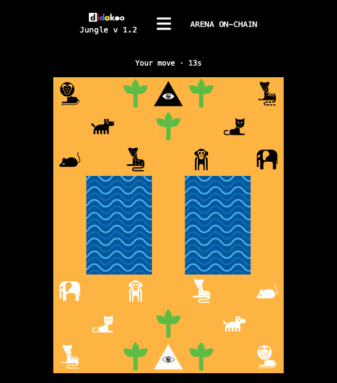
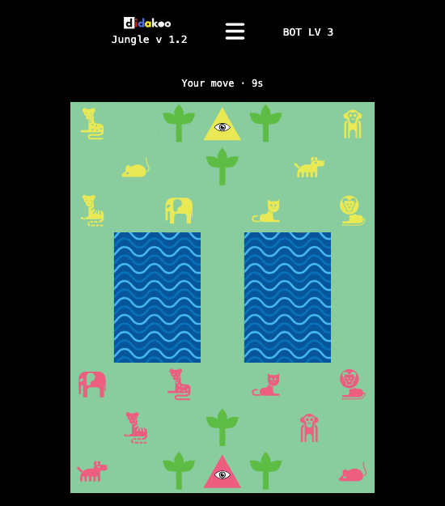
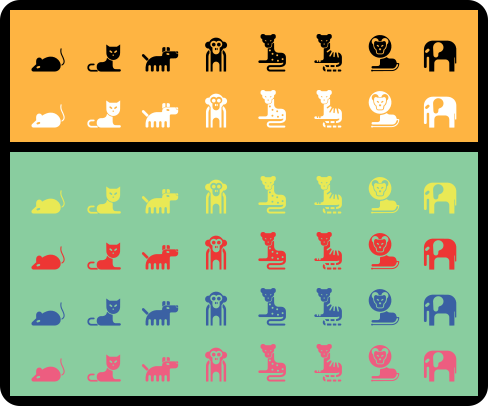
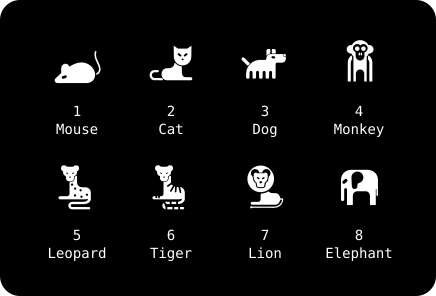
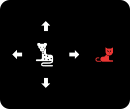
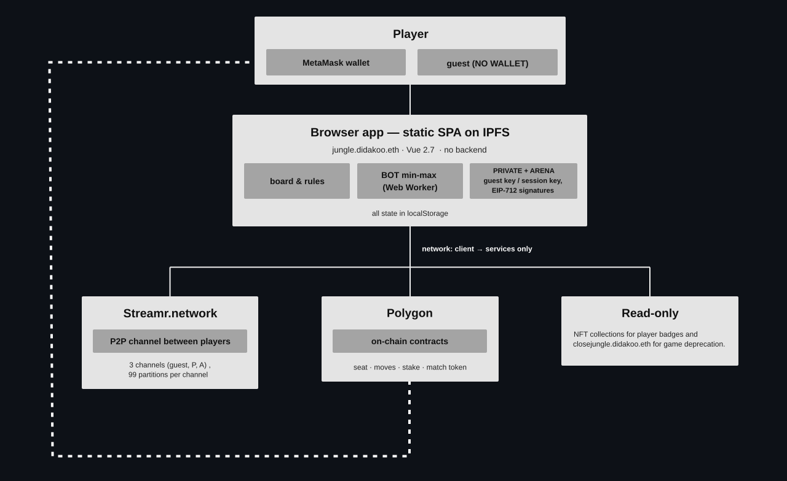

# Jungle v 1.6


> [!WARNING]
> This is a decentralized browser game, a static single-page app pinned on IPFS. The code is open
> source and malicious actors can publish illegal, compromised copies of the game: play only at
> [jungle.didakoo.eth](https://jungle.didakoo.eth.limo) (.limo ENS gateway) or redirected from
> [jungle.didakoo.com](https://jungle.didakoo.com).
> Never share your wallet's recovery phrase, not even with someone posing as support: the game
> will never ask for it.


## How to play
Play as a guest  with NO WALLET, even in a private window, or with a [MetaMask](https://metamask.io/)  wallet on Polygon, which costs nothing to connect. In [Farcaster](https://farcaster.xyz/) it's a Mini App that plays with your Farcaster wallet only.

Keyboard and gamepad supported:

- Move: arrows (D-pad or left stick)
- Select: Enter (A)
- Cancel: Esc (B)


## Animals
Jungle is a 1 vs 1 board game played on a 7 × 9 grid. Each player has 8 animals, each with a
different strength. The initial positions of the animals change with every match. On your turn you move one animal one square up, down, left or right, never diagonally.
<p align="center">
<!--
--><!--
-->
</p>
<p>


</p>

You have 15 seconds to make your move. If time runs out you skip the turn, and your next turn
lasts 5 seconds. You cannot move the same animal more than 6 times in a row. After the 6th move the animal becomes EXHAUSTED:
for one turn it cannot move, and any opposing animal can eat it.


### Special moves :
- The Mouse eats the Elephant. The Elephant cannot eat the Mouse.
- Only the Mouse can enter the water.
- The Lion and the Tiger jump over the water.
- A Mouse in the water blocks every jump across it.


## Plants 
Each player has 3 plants around their pyramid. Your own plants have no effect on your animals.
An animal standing on an opponent's plant loses all of its power, and any defending animal can
eat it.


## Pyramids
The first animal that enters the opponent's pyramid wins the game.


## Modes and Matches
- **Bot**: Play against the computer. No wallet needed, and it is free. Every match has a random bot level, from LV 1 to LV 7.
- **Private**: Press COPY LINK and share it with Player 2 for a private match. Guests and wallets can't play against each other.
  - Guests play for free, with nothing at stake.
  - Wallets play on-chain: every move is a transaction signed by a session key, so your wallet asks for confirmation only at the start of the match. Each player stakes 5 POL per match for the gas and gets back what is left at the end. With a Jungle pass the winner gets a match token. The link carries a one-time invite: Player 2 joins your seat on-chain, even while your app is closed.
- **Arena**: Play against a random opponent. Wallets only, on-chain like a private match, with the same requirements and rewards. Your seat waits on-chain: the next player who opens a seat is paired with it, even while your app is closed, and the match is there when you come back. The turns run meanwhile.
  - The home page lists the latest on-chain matches that minted a match token, Arena and Private, newest first, with both players and the winner marked WIN. Your profile counts the match tokens you hold, Arena and Private.


## Collections
NFT collections recognized by the game, and what they unlock:
- [Jungle didakoo pass](https://opensea.io/collection/jungle-didakoo-pass) (Polygon) - match tokens, the four extra colours and the dog badge
- [Jungle didakoo matches](https://opensea.io/collection/jungle-didakoo-matches) (Polygon) - the match tokens
- [didakoo items 2023](https://opensea.io/collection/didakoo-items) (Ethereum) - the animal badges and the four extra colours; all four coloured elephants add the mouse badge. The leopard, tiger and lion badges also need 50, 150 and 300 Arena match tokens held
- [CryptoKitties](https://opensea.io/collection/cryptokitties) (Ethereum) - cat badge
- [Bored Ape Yacht Club](https://opensea.io/collection/boredapeyachtclub) (Ethereum) - monkey badge


## Architecture
<p align="center">
    
</p>


### The Bot's brain

The bot is a min-max search in `resources/js/engine/minimax.js`: it plays the move that leads
to the highest score, expecting the opponent to answer as well as possible.

- **Level**: the search depth. LV 1 looks one move ahead, LV 7 seven moves ahead; the seed of the match decides the level.
- **Alpha-beta pruning**: it stops exploring a move as soon as it proves worse than one already found.
- **Transposition table**: positions already seen are not searched again.
- **Null-move pruning**: a shortcut that saves time and, rarely, misses the best move.
- **Ties**: between moves with the same score, the bot picks one using the seed of the match; the same position with the same seed always gives the same move.
- **Threads**: Web Workers across the cores, up to half of them and at most 4, and only as many as needed to think within 1.5 s, estimated from a test search timed on the device at the start of the game.

**Weights**: each side gets points according to the table below; the score is the bot's points
minus the opponent's. Points for plants change when animals cross into the enemy half, and grow
a lot when an animal gets close to a pyramid.

<table>
<tr><th>Term</th><th>normal</th><th>attack</th><th>attack, urgent</th><th>defence</th><th>defence, urgent</th></tr>
<tr><td>power</td><td colspan="5">mouse 8 · cat 5 · dog 6 · monkey 7 · leopard 10 · tiger 15 · elephant 20 · lion 25</td></tr>
<tr><td>presence</td><td colspan="5">20</td></tr>
<tr><td>mobility</td><td colspan="5">1 per legal move, 0 if exhausted</td></tr>
<tr><td>in the opponent's three rows</td><td colspan="5">5</td></tr>
<tr><td>the most advanced animal</td><td colspan="5">5 per row gained</td></tr>
<tr><td>on own plant</td><td>2</td><td>2</td><td>2</td><td>10</td><td>10</td></tr>
<tr><td>on unguarded opponent's plant</td><td>5</td><td>20</td><td>200</td><td>5</td><td>300</td></tr>
<tr><td>beside own plant</td><td>5</td><td>5</td><td>5</td><td>20</td><td>200</td></tr>
<tr><td>beside opponent's plant</td><td>0</td><td>10</td><td>100</td><td>0</td><td>0</td></tr>
<tr><td>in the opponent's pyramid</td><td colspan="5">1 000 000</td></tr>
</table>


 
 
### Streamr channels

[Streamr](https://streamr.network) is a decentralized publish/subscribe network: messages travel peer to peer. Each channel is a stream registered on Polygon. Multiplayer uses two streams: guest `jungle-didakoo-guest` and P `jungle-didakoo`.

The guest stream is public: anyone can read and write, and messages are trusted only for their signatures. On P anyone can read, but only granted keys can write: JungleGame grants PUBLISH to a wallet's session key when its seat opens, and revokes it at the end of the match or when the seat is given back. Each stream is split into 99 partitions to keep each match's traffic apart: partition 0 is the meeting point, 1–98 host the matches.


<table>
<tr><th>Mode</th><th>Players</th><th>Moves</th><th>Channel</th><th>Who writes</th><th>Carries</th><th>Partitions</th></tr>
<tr><td><b>BOT</b></td><td>you vs the min-max bot, LV 1–7 from the seed</td><td>in the browser: Web Workers, main-thread fallback</td><td>—</td><td>—</td><td>—</td><td>—</td></tr>
<tr><td><b>PRIVATE</b><br>guest</td><td>invite link, guest ↔ guest</td><td>signed, on Streamr</td><td><b>guest</b><br><code>jungle-didakoo-guest</code></td><td>guests, public</td><td>handshake (30-day delegation, seed reveal), every signed move, Timeout, resync, outcome</td><td>invite: from the link code<br>match: 1–98</td></tr>
<tr><td><b>PRIVATE</b><br>wallet</td><td>invite link with a one-time key, wallet ↔ wallet: the guest joins the host's seat on-chain</td><td>on-chain</td><td><b>P</b><br><code>jungle-didakoo</code></td><td>wallet sessions: PUBLISH granted by JungleGame, revoked at the end</td><td>outcome</td><td>match: 1–98</td></tr>
<tr><td><b>ARENA</b></td><td>a seat waiting on-chain: the next Arena seat is paired with it</td><td>on-chain</td><td><b>P</b><br><code>jungle-didakoo</code></td><td>wallet sessions: PUBLISH granted by JungleGame, revoked at the end</td><td>outcome</td><td>match: 1–98</td></tr>
</table>


### Board creation
The board setup is decided by the seed. Between guests it comes from both players; on-chain it is the hash of a block that nobody knows when the seats are paired. No single player can control it.

<table>
<tr><th>Mode</th><th>Seeds</th><th>Commit</th><th>Reveal</th><th>Final seed</th><th>Decides</th></tr>
<tr><td><b>BOT</b></td><td>32 random bytes from the browser</td><td>—</td><td>—</td><td>that seed</td><td>board, colours, bot level (LV 1–7), the bot's tie-breaks</td></tr>
<tr><td><b>PRIVATE</b><br>guest</td><td>one per player, 32 random bytes</td><td>keccak256(seed) in the signed Commit on Streamr; both commits go into the Match signed by both</td><td>Reveal on Streamr after the Match; each seed checked against its commit</td><td>XOR of the two</td><td>board, colours, sides</td></tr>
<tr><td><b>PRIVATE</b><br>wallet<br><b>ARENA</b></td><td>the hash of the block after the pairing (N+1)</td><td>—</td><td>read by both clients once block N+1 is final; JungleGame writes it with the first move; without a move before block N+256 the match closes and each stake goes back</td><td>that hash</td><td>board, colours, sides</td></tr>
</table>


### Polygon contracts

The contracts in `contracts/src` are deployed on Polygon with no admin functions and no upgrade path.
<table>
<tr><th>Contract</th><th>Role</th><th>Who calls it</th><th>Values</th></tr>
<tr><td><b>JungleGame</b><br><a href="https://polygonscan.com/address/0x08671180Bb07e90de3Ba135908d41368F730aF7d"><code>0x08671180Bb07e90de3Ba135908d41368F730aF7d</code></a></td><td>seats, the Arena queue and the private invites, the pairing, the seed from the block after it, stake, every move verified against the rules, deadlines from the block, end and mint; grants PUBLISH on P to the session</td><td>wallet: Open · Join · Leave<br>session: Move · Resign<br>anyone: Close · Withdraw · Sunset</td><td>stake 5 POL · float 1 POL<br>white's first turn 5 s after the pairing<br>turn 20 s, 10 after a skip<br>seed within 256 blocks · idle 10 min</td></tr>
<tr><td><b>JungleRules</b></td><td>library: the rules ported from the JS game; every move checked for legality and applied</td><td>JungleGame, on every move</td><td>library, no address</td></tr>
<tr><td><b>JungleRulesTables</b></td><td>library: the rules' tables, generated from the engine</td><td>JungleRules</td><td>library, no address</td></tr>
<tr><td><b>JungleSeed</b></td><td>library: what the seed decides (board, colours, sides), ported from the JS game</td><td>JungleGame, at the start<br>JungleMemento, for the image</td><td>library, no address</td></tr>
<tr><td><b>JunglePass</b><br><a href="https://polygonscan.com/address/0x347D3ae3039b40fd6247d328821387391e113aa1"><code>0x347D3ae3039b40fd6247d328821387391e113aa1</code></a></td><td>Jungle didakoo pass editions (ids 1, 5, 6, 7, 8)</td><td>JungleGame, at the end, for the mint<br>client, for the profile</td><td>read-only</td></tr>
<tr><td><b>JungleMemento</b><br><a href="https://polygonscan.com/address/0x1F1318ADEC325Ad3338d928738636929B393d60c"><code>0x1F1318ADEC325Ad3338d928738636929B393d60c</code></a></td><td>match token minted to the winner (tokenId = gameId), only if they hold the pass</td><td>JungleGame: mint<br>client: tokensOf · drawing · totalMinted</td><td>image and replay on-chain</td></tr>
<tr><td><b>JungleArt</b><br><a href="https://polygonscan.com/address/0xA1C790d7b63210d92653069b0681131d77e3Dc6b"><code>0xA1C790d7b63210d92653069b0681131d77e3Dc6b</code></a></td><td>the shapes of the match token image, generated from the bundle SVGs</td><td>JungleMemento</td><td>separate because of the 24 KB size cap</td></tr>
<tr><td><b>JungleReplay</b><br><a href="https://polygonscan.com/address/0x1239839a2B7FB20862b336b65c350917f752fe3C"><code>0x1239839a2B7FB20862b336b65c350917f752fe3C</code></a></td><td>the replay script of the match token: <code>animation_url</code></td><td>JungleMemento</td><td>omitted above 2000 turns</td></tr>
</table>


### RPC failover

The browser reaches each chain through public JSON-RPC endpoints, tried in this order. An endpoint that doesn't answer, or takes over 2 s to answer, hands over to the next one; after 60 s the first one is tried again. Reads that wait over 2 s are sent to the next endpoint too, and the first answer wins. Nonce, gas estimate and transactions never race. A revert or a refused transaction is the chain's answer, not the endpoint's fault: it is not retried elsewhere.

**Polygon** (chain ID 137): the session's transactions, every read of the match, the pass, the latest matches.

1. `polygon.gateway.tenderly.co`
2. `137.rpc.thirdweb.com`
3. `polygon.drpc.org`
4. `polygon-bor-rpc.publicnode.com`

**Ethereum**: the NFT badges only.

1. `ethereum-rpc.publicnode.com`
2. `mainnet.gateway.tenderly.co`
3. `eth.drpc.org`


## Verify the build
To prove that the version served at `jungle.didakoo.eth` is exactly the code in this repository. The ENS name points to an IPFS CID (its content hash, readable on
[app.ens.domains](https://app.ens.domains/jungle.didakoo.eth)). Anyone can rebuild that CID from this
repository: if the two match, the game served is this code.

```bash
# 1. get the code
git clone https://github.com/didakoo-hub/jungle
cd jungle

# 2. use the same Node version as the release (22.18.0, read from .nvmrc)
nvm use

# 3. install the exact dependencies of package-lock.json
npm ci

# 4. build the app into dist/
npm run build

# 5. compute the CID of dist/ without publishing anything
#    needs kubo 0.43.0 (https://dist.ipfs.tech/#kubo); "ipfs init" only the first time
ipfs init
ipfs add -rQ --only-hash --cid-version 1 dist

# 6. compare the printed CID with the content hash of jungle.didakoo.eth
```

The Farcaster Mini App is served from `jungle.didakoo.com`, a copy of the same `dist/`. With the
`dist/` built above, this compares every file it serves now with yours:

```bash
node tools/worker-dist.js --check
```

## Copyright
© 2026 didakoo. All rights reserved: code and artwork. 

info@didakoo.com
